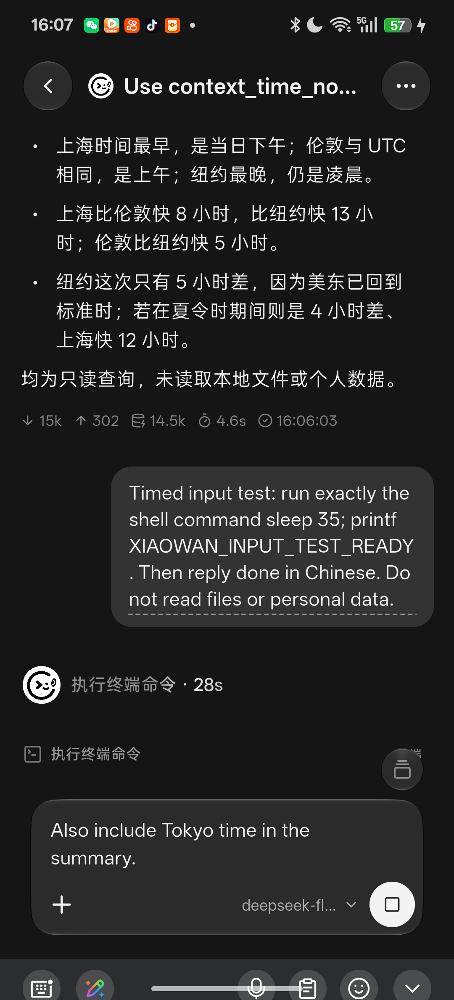
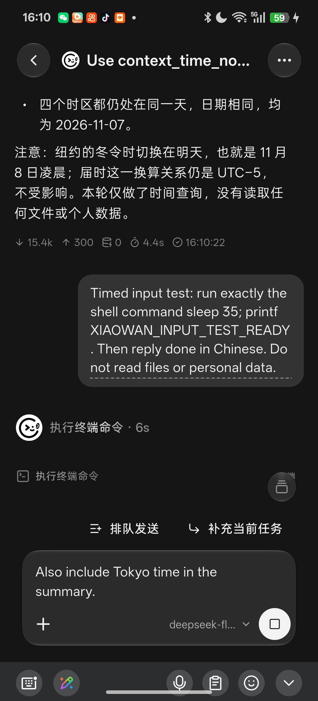

# 小万执行与输入接续优化验收

基线为 `611a2388391590993f0520d36866207f415c02d0`。为排除手机旧安装版本的差异，先从该提交的隔离源码构建 0.7.0.4 调试 APK，再安装工作区修改版。两个阶段均使用同一台 PJD110 Android 真机，以及用户在聊天页选定的 `deepseek-flash`；未替换模型配置、账号或凭据。

## 行为对比

| 项目 | 优化前 | 优化后 |
| --- | --- | --- |
| 执行中输入 | 可以打字，主按钮只有停止，不能提交补充 | 独立“排队发送”“补充当前任务”入口，保留停止按钮 |
| 下一条任务 | 必须等当前结束后再次手动发送 | Conversation 所属 FIFO，成功 PromptResponse 后发送下一条 |
| 当前任务补充 | 无非中断提交入口 | 协商 steering 能力，绑定当前 session/turn；工具结束后的模型边界消费，不取消重跑 |
| 独立只读工具 | 同一轮全部串行 | 显式能力允许的读取最多 4 项同时执行；空出的槽位立即复用 |
| 有依赖或副作用的工具 | 串行 | 保留独占屏障，未知插件工具也默认独占 |
| 执行沟通 | 逐项等待的指令限制调度 | 简单任务直接执行，仅在有意义的进展、阻塞或需要决策时说明 |
| 上下文压缩 | 最新用户输入及摘要延续 | 当前 prompt 原始输入与所有补充精确保留，预算内保留外存结果引用，明确区分完成、未知和待做 |
| 终端日志 | 自动日志成为独立附件卡 | 明确标记为执行日志，保留工具详情；普通交付文件仍显示附件卡 |
| 停止、失败和恢复 | 无输入队列 | 队列暂停且保留；重启不自动重放；未确认补充保留可查看的输入回执 |

长期记忆存储布局和 API 保持兼容，用户明确要求才写入；更新的是检索使用策略、工作上下文和恢复依据。没有用 UI 状态或第二套协议模拟 Agent 生命周期。

## 真机截图

| 优化前：执行中只有停止 | 优化后：排队或补充当前任务 |
| --- | --- |
|  |  |

[待发送队列与正在运行的工具共存](after/03-queued-during-tool.png) · [追加要求完成后的结果](after/02-steering-completed.png) · [切换到其他会话后没有队列串入](after/04-other-conversation.png)

PNG 均由 `adb exec-out screencap -p` 直接获取，未合成或重绘。旁边 XML 是 UIAutomator 可访问性快照；截图和 XML 相隔一次界面读取，秒数可能略有差异。

## 已完成的真实模型/真机验证

- 基线和优化版均完成公开时区查询，产生真实工具结果和助手正文。
- 基线执行 `sleep 35; printf XIAOWAN_INPUT_TEST_READY` 时，补充草稿只能等待；截图显示停止按钮。
- 优化版同一命令运行期间接入“补充东京时间”，命令仍正常结束，随后答复包含东京时间。没有发送取消或重新执行原命令。
- 独立执行 `sleep 60; printf QUEUE_RUNNING_OK` 时，下一条 `QUEUE_FOLLOWUP_OK` 被保留在待发送列表。
- 返回会话列表并进入原基线会话，队列没有出现在该会话；之后列表中目标会话显示命令已完成及 `QUEUE_FOLLOWUP_OK` 回复，证明后台接续。最后完成状态通过新鲜 UIAutomator 读取观察到；设备断开前未另存最终完成截图。

这些任务只使用公开时间或等待后打印固定标记，不读取私人文件。较早的目录/技能读取测试被自动审批拦截，未执行，也未用来形成结论。

## 调度测量

`AgentOrchestratorTest.reportsSerialAndBoundedReadSchedulingWithIdenticalResults` 对同样 4 个各延迟 80ms 的模拟读取，分别关闭和开启显式并发许可：

| 测量 | 串行 | 受限并发 |
| --- | ---: | ---: |
| 本次调度总耗时 | 372.3ms | 89.4ms |
| 最大同时执行数 | 1 | 4 |
| 结果顺序与内容 | 一致 | 一致 |

证据见 [scheduling-benchmark.xml](scheduling-benchmark.xml)。测试断言并发上限和结果一致性，不断言易波动的速度比例。这是纯调度测量，不能声称真实模型、网络或完整任务获得同样加速。真实模型的两次简短查询缓存状态不同，不能作为性能基准。

## 最终自动化验证

- Android：14 个相关测试类，共 **190 项通过，0 失败、0 错误**。包含调度、取消/未知结果、压缩与引用预算、steering、session 关闭、会话归属、子任务能力及 ACP artifact 用途。见 [native-tests.json](native-tests.json)。
- Flutter：7 个相关测试文件，共 **449 项通过**，包含输入专项 17 项与共享 reducer 207 项。覆盖队列持久化失败/完成竞态、Stop 发生于发送准备阶段、未确认补充禁止覆盖、真实历史落盘屏障、重启暂停、删除清理、附件和普通交付物展示。
- `flutter analyze --no-fatal-warnings --no-fatal-infos`：退出码 0，0 error；仍报告 53 warning 和 490 info，不将其描述为零告警。
- `git diff --check` 通过；`assembleDevelopStandardDebug` 成功。
- APK 与基线、截图版本的 SHA-256 见 [verification.json](verification.json)。最终调试 APK 位于工作区 `app/build/outputs/apk/developStandard/debug/app-develop-standard-debug.apk`，最后一版未安装到手机。

## 验证范围与限制

用户在真机断连后明确要求不再做 ADB 测试；此后没有继续操作设备。已采集截图对应第一版可运行实现，后续完善了输入落盘、停止/提交竞态、删除清理及执行日志展示。这些后续修复通过自动化验证，但未重新安装到手机，也没有新的真机截图。停止后的队列恢复、应用进程重启、长上下文压缩及最新日志展示的最终真机复验未执行。

本次只在本地实现和构建，未提交、推送或发布。

设计来源与固定引用见 [架构参考](../../third-party/xiaowan-agent-design-references-20261107.md) 和 [steering 扩展来源](../../third-party/acp-steering-design.md)。
